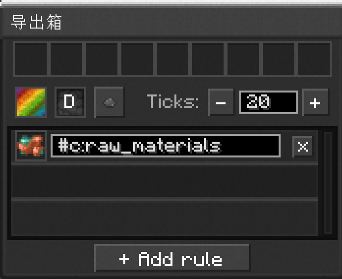
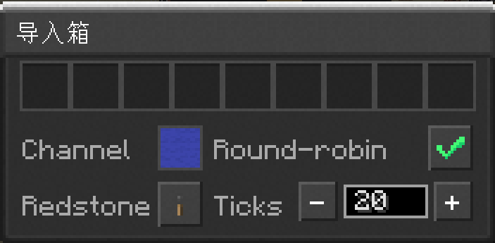
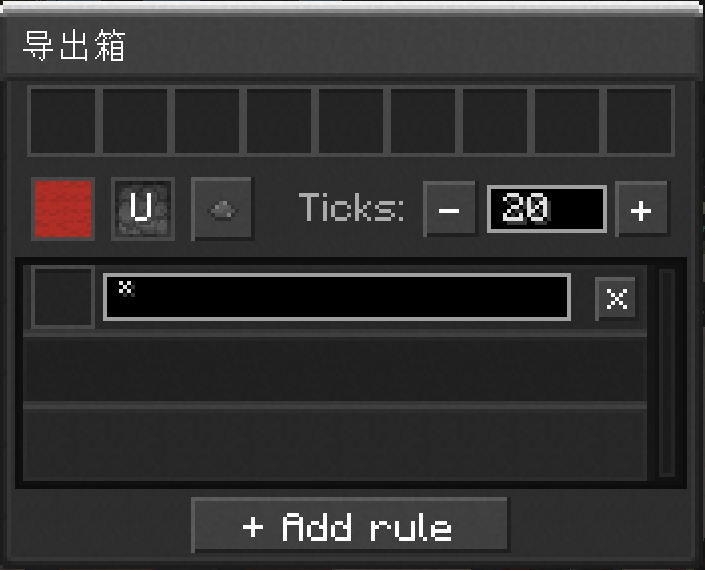
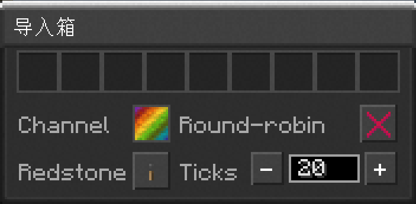

---
navigation:
  parent: example-setups/index.md
  icon: minecraft:furnace
  title: 自动化烧炼子网
categories:
  - example
---

# 自动化烧炼子网

你可以用<ItemLink id="export_chest" />和<ItemLink id="import_chest" />桥接两个网络。此示例中的大网络会向熔炉阵列所在的小网络送出`#c:raw_material`物品，小网络再将产物送回大网络。

<GameScene zoom="4" interactive={true} paddingLeft="30" paddingRight="30">
  <ImportStructure src="../assets/assemblies/automated_smelting.snbt" />
  <IsometricCamera yaw="190" pitch="10" />
  <DiamondAnnotation pos="7.5 4 0.5" color="#ff0000">
  <BlockAnnotation x="7" y="4">
  
  </BlockAnnotation>
  <BlockAnnotation x="7" y="3">
  
  </BlockAnnotation>
  <BlockAnnotation x="5" y="3">
  
  </BlockAnnotation>
  <BlockAnnotation x="5" y="4">
  
  </BlockAnnotation>
    存储网络导出箱，在GUI中设为向下方送出物品。

    **这两个箱子之间没有连接，它们分属于两个网络。**
  </DiamondAnnotation>
  <DiamondAnnotation pos="5.5 4 0.5" color="#ff0000">
    熔炉网络导出箱，在GUI中设为向上方送出物品。

    **这两个箱子之间没有连接，它们分属于两个网络。**
  </DiamondAnnotation>
  <BoxAnnotation min="5 0.75 0" max="8 1 1" color="#B02E26">
    设为红色频道的<ItemImage id="storage_card" />存储卡，正被导出箱抽取；筛选器为`*`，即抽取所有资源
  </BoxAnnotation>
  <BoxAnnotation min="5 2 0" max="8 2.25 1" color="#3C44AA">
    设为蓝色频道的<ItemImage id="storage_card" />存储卡，正被导入箱送入，模式为轮询
  </BoxAnnotation>
</GameScene>

也可用<ItemLink id="terminal" />达成同样的功能，且灵活性更高。

<GameScene zoom="4" interactive={true} paddingLeft="30" paddingRight="30">
  <ImportStructure src="../assets/assemblies/automated_smelting_scripting.snbt" />
  <IsometricCamera yaw="190" pitch="10" />
  <BoxAnnotation min="5 1 0" max="8 1.25 1" color="#22C55E">
    <ItemImage id="io_card" />IO卡
  </BoxAnnotation>
</GameScene>

脚本如下：

<LuaCode>
```lua
local furnaces = network:cards("furnace_*")
-- 向熔炉送入粗矿和矿石
importer
    :from(network)
    :to(furnaces:face("top"))
    :filter("#c:raw_materials")
    :filter("#c:ores")
    :roundrobin()
    :start()
-- 将处理得到的锭送出熔炉
importer
    :from(furnaces:face("bottom"))
    :to(network)
    :start()
```
</LuaCode>
